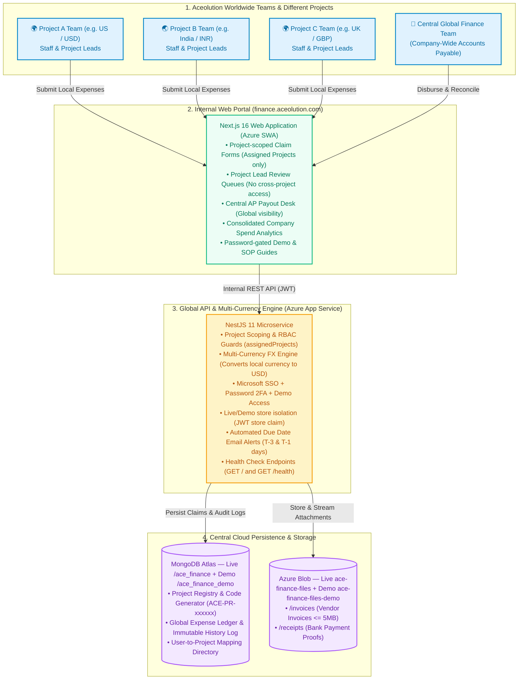
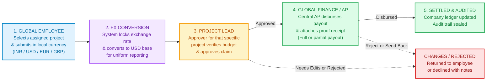

# Aceolution Finance — Complete System Architecture Blueprint

## 1. Executive Summary & Live Deployments

**Aceolution Finance** is a company-internal spend, reimbursement, and expense management platform operating at a **global level across different projects, regions, and currencies**. 

The system enables internal employees worldwide to raise project-scoped expenses in their local currencies, normalizes amounts to a corporate USD base via real-time FX rates, enforces strict segregation of duties (SoD) through project-scoped manager approvals, and enables central Accounts Payable (AP) to disburse partial or full payments with proof-of-payment receipts.

### Live Production Environments

| Component | Target URL | Hosting Platform | Runtime / Config |
|:---|:---|:---|:---|
| **Web Frontend** | [https://finance.aceolution.com/](https://finance.aceolution.com/) | Azure Static Web Apps | Next.js 16 (Static Export `./out`), Custom Domain, CDN Edge |
| **Backend API** | [https://ace-finance-api-f5hnhhd6c3bvffhj.southindia-01.azurewebsites.net/](https://ace-finance-api-f5hnhhd6c3bvffhj.southindia-01.azurewebsites.net/) | Azure App Service (South India) | NestJS 11 + Node.js 20 Linux Plan, Port 3001/80 |

---

## 2. Master System Architecture Diagram



---

## 3. Financial Expense Flow & Payout Lifecycle



---

## 4. Frontend Architecture (`ace_finance_frontend`)

### 4.1 Technology Stack
- **Framework**: Next.js 16 (App Router) + React 19 + TypeScript
- **Styling**: Tailwind CSS 4
- **Build Mode**: Static export (`output: "export"`) compiling to `./out`
- **Node.js**: `>=20 <23`
- **API Connection**: Interacts with the NestJS API via `NEXT_PUBLIC_API_URL`

### 4.2 Role Matrix & UI Scope

| Role | Main Application Areas | Project Scope & Boundary |
|:---|:---|:---|
| **`REQUESTER`** | Submit Expense, My Requests | **Assigned projects only** (restricted dropdown + Profile chips) |
| **`APPROVER`** | Approver Queue | **Assigned projects only** (restricted queue, alert emails, Profile chips) |
| **`PROCESSOR`** | Processor / Payment Queue | **All approved expenses** (global, not project-scoped) |
| **`ADMIN`** | Users, Categories, Projects, Countries | **All system master data** (global, not project-scoped) |

### 4.3 UI Highlights & Feature Integrations
- **Profile View & Access Scope**:
  - Requester / Approver: View mode shows **Assigned Projects** as read-only chips (scrollable when numerous). Editing hides project assignments.
  - Admin / Processor: View mode shows **Access Scope** instead of project lists.
- **Submit Expense Workspace**:
  - Split layout with submission form on the left.
  - Desktop right panel: **What happens next** (4 visual workflow steps) and **Your recent requests** (latest 4 submissions or "No data").
- **Dashboard Filtering**:
  - Header filter controls: Project dropdown + `submittedAt` date range picker (From / To).
- **Password-Gated Documentation & Guides**:
  - Interactive product guides available at `/demo-guide`, `/docs-guide`, and presentation slide mode at `/docs-guide/present`.
  - Unlocked by `NEXT_PUBLIC_DEMO_GUIDE_ACCESS_PASSWORD`.
- **In-App Notifications**:
  - Backend notification tracking APIs operational; bell UI temporarily hidden while preserving underlying endpoints.

### 4.4 Environment Configuration & Build Scripts

```env
# Frontend .env (Local)
NEXT_PUBLIC_API_URL=http://localhost:3001
NEXT_PUBLIC_APP_URL=http://localhost:3000
NEXT_PUBLIC_DEMO_GUIDE_ACCESS_PASSWORD=your-demo-password

# Production (Set in Azure SWA or .env.deploy)
NEXT_PUBLIC_API_URL=https://ace-finance-api-f5hnhhd6c3bvffhj.southindia-01.azurewebsites.net
NEXT_PUBLIC_APP_URL=https://finance.aceolution.com
NEXT_PUBLIC_DEMO_GUIDE_ACCESS_PASSWORD=your-secure-demo-password
```

#### NPM Commands
- `npm run dev` — Next.js development server (Port 3000)
- `npm run build` — Generates static export in `./out`
- `npm run preview` — Locally serves the `./out` static directory
- `npm run deploy:azure` / `.\scripts\deploy-azure-swa.ps1` — One-command production deployment to Azure SWA using `SWA_DEPLOYMENT_TOKEN` from `.env.deploy`.
- Automated Documentation Screenshot Scripts: `capture-docs-refresh.cjs`, `capture-docs-updated-ui.cjs`, `capture-docs-auth.cjs`, `capture-docs-confirm-preview.cjs`, `capture-docs-screenshots-gaps.cjs`.

---

## 5. Backend Architecture (`ace_finance_backend`)

### 5.1 Technology Stack
- **Framework**: NestJS 11 + TypeScript
- **Database**: MongoDB Atlas via dual Mongoose connections — Live `/ace_finance` (`MONGODB_URI`) and Demo `/ace_finance_demo` (`MONGODB_URI_DEMO`)
- **Authentication**: Microsoft Entra SSO + JWT / Passport + password 2FA (Email OTP + TOTP) + Demo Access + Live/Demo workspace choice
- **Object Storage**: Azure Blob — Live `ace-finance-files` and Demo `ace-finance-files-demo` (folders `/invoices` and `/receipts`)
- **Node.js**: `>=20 <23`
- **Local Port**: `3001`
- **Auth / store isolation detail**: see [`AUTH_LIVE_DEMO_STORES.md`](./AUTH_LIVE_DEMO_STORES.md)

### 5.2 Core Business Features & Security
- **Sign-in paths**: Microsoft (company MFA) · Demo Access (dynamic `isDemo` list in demo DB) · Password (`Use password instead`) with Choose Workspace when email exists in both stores
- **Dual-Factor Authentication (2FA)** (password accounts):
  - Email OTP: 6-digit code, SHA-256 hashed, expiring in 10 minutes.
  - TOTP Authenticator: RFC 6238 compliant QR setup for authenticator apps.
  - Password Management: Reset tokens, forgot password, forced first-time change (`mustChangePassword`) — not for Microsoft-linked accounts.
- **Demo Access (`isDemo: true` in demo store)**:
  - `GET /auth/demo-accounts` / `POST /auth/demo-login`; Admin toggles visibility in Demo workspace → Users.
  - Seeded `@acefinance.com` training personas; JWT `store: "demo"` isolates data and blobs from Live.
  - Demo Seed Endpoint: `POST /auth/seed` (and automated startup boot seed for both stores).
- **Expense State Machine**:
  - Workflow: `submit` $\rightarrow$ approver `approve` / `reject` / `request-changes` $\rightarrow$ processor `pay` / `partial-pay` / `reject`.
  - Immutable audit history logging user, timestamp, action, and financial delta.
- **Scheduled Escalations & Due-Soon Reminders**:
  - Automated cron jobs check invoice due dates:
    - Approver reminder dispatched **3 days** before due date.
    - Escalation alert dispatched **1 day** before due date.
- **Health Checks**:
  - `GET /` and `GET /health` endpoints for Azure App Service uptime probes.

### 5.3 3-Tier Transactional Email Priority Chain

```
[Expense / Auth Event]
         │
         ▼
[1. Azure Communication Services (ACS)] ──► Succeeded ──► Delivered
         │ (Failed / Not Configured)
         ▼
[2. Resend HTTPS API (Fallback)]       ──► Succeeded ──► Delivered
         │ (Failed / Not Configured)
         ▼
[3. SMTP Transport (Gmail / Custom)]    ──► Succeeded ──► Delivered
         │ (Failed)
         ▼
[Non-blocking Error Logged] (Financial transaction never aborted)
```

1. **Azure Communication Services (ACS) Email** (Preferred): Used when `AZURE_COMMUNICATION_CONNECTION_STRING` and `AZURE_EMAIL_SENDER` (e.g. `DoNotReply@….azurecomm.net`) are set.
2. **Resend API**: Triggered when `RESEND_API_KEY` is present.
3. **SMTP Relay**: Fallback using `SMTP_HOST`, `SMTP_USER`, and `SMTP_PASS`.

### 5.4 Environment Configuration & NPM Scripts

```env
# Backend .env
MONGODB_URI=mongodb+srv://.../ace_finance?retryWrites=true&w=majority
JWT_SECRET=your-long-random-secret
PORT=3001
FRONTEND_URL=http://localhost:3000
AZURE_STORAGE_CONNECTION_STRING=DefaultEndpointsProtocol=https;AccountName=...
AZURE_STORAGE_CONTAINER=ace-finance-files
AZURE_COMMUNICATION_CONNECTION_STRING=endpoint=https://...;accesskey=...
AZURE_EMAIL_SENDER=DoNotReply@your-domain.azurecomm.net
SMTP_HOST=smtp.gmail.com
SMTP_USER=your-email@gmail.com
SMTP_PASS=your-app-password
RESEND_API_KEY=re_...
```

#### NPM Commands
- `npm run start:dev` — Nest watch mode for development
- `npm run build` — Compiles TypeScript into `dist/`
- `npm run start:prod` — Runs compiled production application
- `npm run lint` — ESLint validation
- `npm test` — Unit test suite execution

---

## 6. Duplicate Submission & Fraud Prevention Architecture

To prevent duplicate reimbursement claims where different team members attempt to submit the same invoice (or the same employee accidentally submits twice), Aceolution Finance implements a multi-tier prevention engine:

```
[User Submits Form + Invoice File]
                │
                ▼
   [Step 1: Compute SHA-256 Hash]
     fileHash = SHA256(file.buffer)
                │
                ▼
   [Step 2: Pre-Flight Duplicate Check] ──► (Match Found?) ──► Throw 400 BadRequest
   • Is exact fileHash already in DB?                          (Zero storage waste,
   • Is invoiceNumber already in Project?                       No orphan blobs)
   • Is invoiceNumber + amount/date in DB?
                │ (Passes)
                ▼
   [Step 3: Upload to Azure Blob Storage]
     /invoices/{expenseId}-original.pdf
                │
                ▼
   [Step 4: Atomic DB Persistence]
     Stores invoiceFileHash & invoiceNumberNormalized
     (Excludes REJECTED_APPROVER / REJECTED_PROCESSOR)
```

### Key Security & Verification Pillars
1. **Cryptographic Binary Hashing (SHA-256)**:
   - Regardless of whether the user renames the file (e.g. `invoice.pdf` $\rightarrow$ `receipt_claim.pdf`), the SHA-256 binary hash remains identical.
   - Any re-submission of an identical invoice document is blocked globally across all projects.
2. **Normalized Invoice Number Indexing**:
   - Symbols, punctuation, and whitespace are stripped and normalized to lowercase (e.g. `INV # 2024 - 001` $\rightarrow$ `inv2024001`).
   - Prevents bypass through formatting alterations. Generic placeholders (`N/A`, `None`, `0`) are ignored to prevent false positives.
   - Prohibits duplicate invoice numbers within the same project, and cross-project duplicates with matching amounts or dates.
3. **Pre-Flight Controller Gate (Azure Cost & Storage Optimization)**:
   - Checks for duplicates **before** streaming binary data to Azure Blob Storage. This guarantees zero orphaned blobs and zero wasted bandwidth.
4. **Legitimate Re-submission Support**:
   - Expenses with status `REJECTED_APPROVER` or `REJECTED_PROCESSOR` are excluded from the duplicate block, allowing requesters to rectify rejected claims when necessary.
5. **Hard block vs soft warning**:
   - **Hard duplicate** (file hash / invoice number rules) → HTTP `400` · request is **not created** (auto-blocked at submit; not a Rejected workflow status).
   - **Potential duplicate** (“fuzzy triple”: same project + category + amount within ±1 day) → UI warning modal; requester must confirm (`duplicateConfirmed`) to proceed.
6. **In-app docs**: `/docs-guide/#duplicates` · `/architecture/#duplicates`


